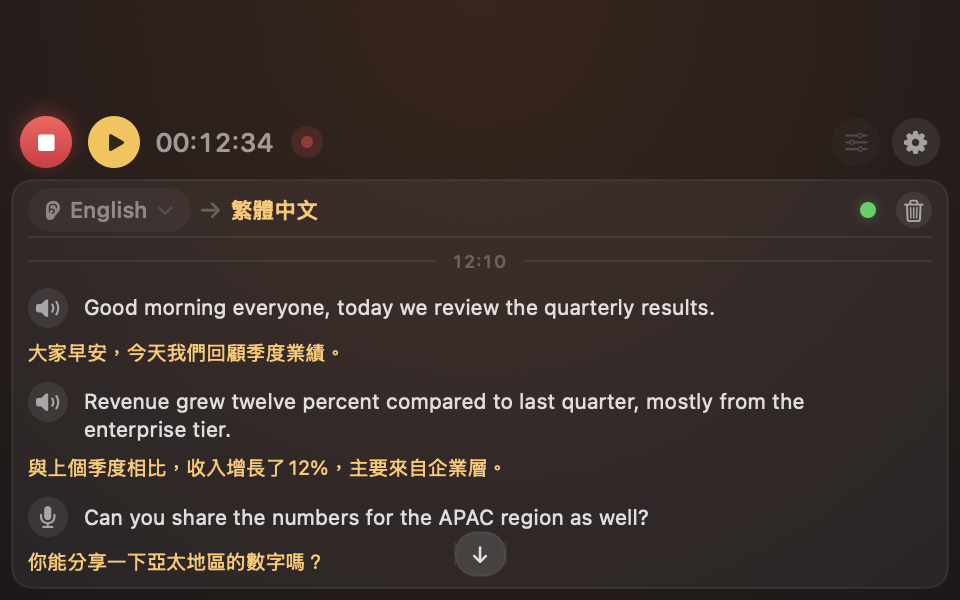
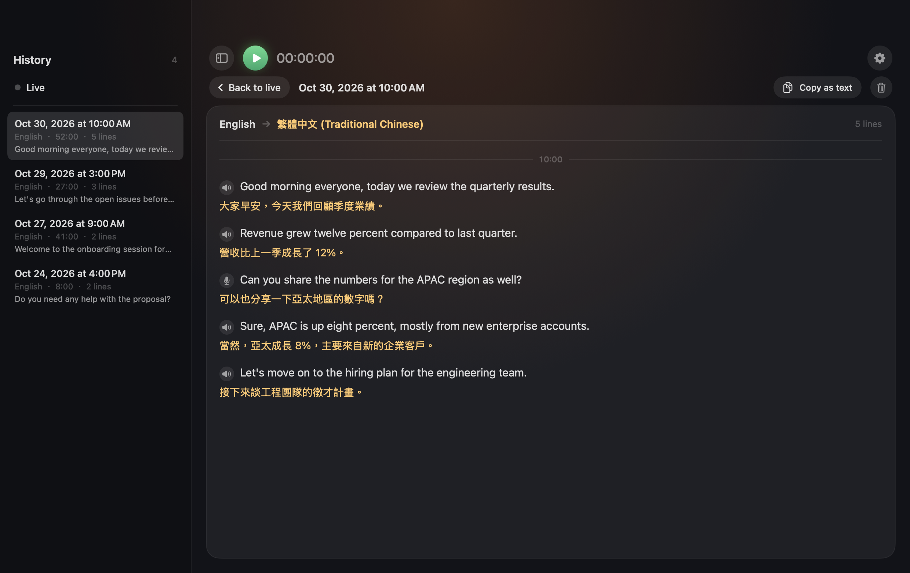
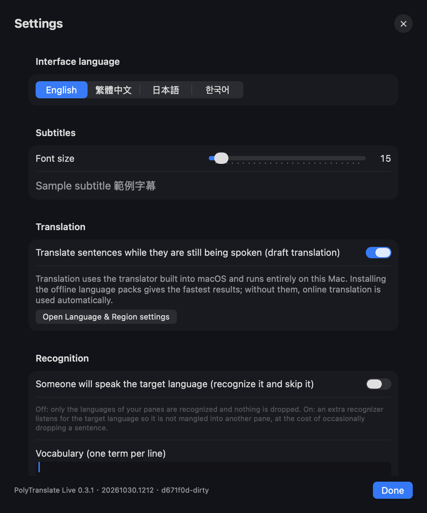
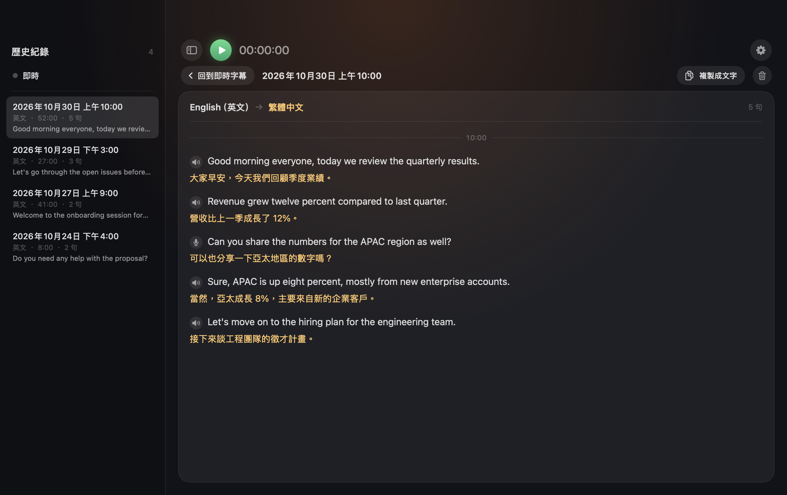

<p align="center">
  
</p>

<h1 align="center">PolyTranslate Live · 多語即譯</h1>

<p align="center">
  Live meeting subtitles, translated on your Mac. Several languages are recognized in parallel and routed to their own pane,<br>
  built entirely on Apple's on-device speech and translation models. No API keys, no subscription, no cloud.
</p>

<p align="center">
  <a href="#english">English</a> · <a href="#繁體中文">繁體中文</a>
</p>

---

## English


### System requirements

| | Requirement |
|---|---|
| macOS | **26.4 (Tahoe) or later** — uses `SpeechAnalyzer` and the `TranslationSession(installedSource:…)` API introduced in macOS 26 / 26.4 |
| Chip | **Apple Silicon** (M1 or later). Intel Macs are not supported. |
| Build tools | Xcode **Command Line Tools** with the macOS 26 SDK. **Xcode itself is not required.** |
| Permissions | Microphone; Speech Recognition; Screen & System Audio Recording (for capturing what your Mac is playing) |
| Network | Not required. Install the offline translation language packs for fastest results; otherwise macOS falls back to online translation automatically. |

### What it does

- **One slim toolbar, the rest is subtitles.** Start/Stop, Pause, the timer and the REC badge sit on the left; the language you want to read, the audio source, “add pane” and Settings on the right. Nothing else competes with the text.
- **Pick the audio source:** system audio (meetings, videos), microphone, or both mixed.
- **Each pane listens for one language.** Start with one pane (English → Traditional Chinese) and add more, e.g. a Japanese pane, up to four.
- **Automatic routing by language.** Every pane's language is recognized in parallel on the same audio; when a sentence is finalized, the recognizer with the highest confidence wins and the sentence appears in that pane. The target language can run as a silent lane so that, say, Chinese speech never shows up as garbage in the English pane.
- **Live drafts.** While someone is still talking you see a gray draft and a draft translation; it turns solid when the sentence ends. A time marker appears every five minutes.
- **Mixed input without mixing audio.** System audio and microphone each get their own recognizers; lines are tagged with a speaker or mic icon. When both hear the same sentence (headphone leakage, headset crosstalk, speakers picked up by the mic), only the first copy is kept.
- **Pause and resume (⌘P).** Pausing stops subtitles and recording without ending the session; resume and everything continues in the same history entry and the same audio file, with no silent gap. The timer excludes paused time.
- **Nothing is lost if the app dies.** While a session runs, the history entry and the optional transcript are checkpointed every 30 seconds, and the recording is written in 10-second fragments that stay playable. A force quit, a crash or a power cut costs at most the last half minute; such sessions are marked with a warning icon.
- **Full audio recording.** Every session is recorded (AAC, 16 kHz mono, about 15 MB per hour) and kept with its history entry. Open a past session and press **Save recording** to export the .m4a. Turn it off in Settings › Recording.
- **History sidebar.** Browse past sessions, copy a session as text, export its recording or delete it. Optionally also save a Markdown transcript to Documents › PolyTranslate Live (off by default; enable in Settings).
- **Works in a quarter of the screen.** The layout scales down to 360×240: the toolbar folds its menus into one button, fonts shrink, and the subtitles keep the room. Scroll up to read earlier lines without being pulled back; a “back to latest” button returns you.
- **Interface in English, Traditional Chinese, Japanese or Korean.** Language names show as *native name (name in your UI language)*, e.g. `日本語 (Japanese)`.
- **Vocabulary and wording.** Settings › Recognition takes a list of names and jargon the recognizer should prefer (fed to SpeechAnalyzer as contextual strings). Settings › Chinese wording converts Traditional Chinese translations to Taiwan terms (built-in OpenCC table plus your own rules).

<p align="center">
  
  
</p>

### Speed (measured on Apple Silicon)

| Stage | Latency |
|---|---|
| First draft word after speech starts | ~1 s |
| Sentence finalized after the speaker pauses | < 0.1 s |
| Translation, offline language pack installed | ~30–80 ms |
| Translation, online fallback | 0.3–1 s |

### Install

**Easiest: clone, then double-click.**

```bash
git clone https://github.com/SamLiaoP/polytranslate-live.git
```

Open the `polytranslate-live` folder in Finder and double-click **`Install.command`**. Terminal opens and the script checks your Mac (Apple Silicon, macOS 26.4+), installs the Xcode Command Line Tools if they are missing (no Xcode needed), builds the app, puts it in `/Applications` and launches it. Double-click it again later to update. The installer never asks for your password and does not touch your keychain; the only dialogs are macOS's own permission prompts. If you downloaded the repo as a ZIP instead of cloning, right-click `Install.command` and choose Open the first time, because macOS quarantines downloaded files.

**From Terminal instead:**

```bash
git clone https://github.com/SamLiaoP/polytranslate-live.git
cd polytranslate-live
./build.sh install   # compiles with swiftc, signs, installs to /Applications/PolyTranslate Live.app
```

The app then shows up in Launchpad, Spotlight and Finder › Applications like any other app.
`./build.sh run` does the same and launches it; `./build.sh` alone only builds into `build/`.

#### Let an AI install it for you

If you use an AI coding assistant (Claude Code, Codex, Cursor, Copilot, …), just hand it the repo. The
repository ships an [`AGENTS.md`](AGENTS.md) with the exact requirements, commands, permission steps and
a verification routine, so the assistant can do everything except click the permission dialogs. Paste
something like:

> Clone https://github.com/SamLiaoP/polytranslate-live and install it on this Mac. Follow AGENTS.md,
> check the system requirements first, and tell me which permission dialogs I need to click.

### First start: permissions

On the first **Start**, macOS asks for:

1. **Microphone** and **Speech Recognition**.
2. **Screen & System Audio Recording** — needed to capture system audio. After enabling it in System Settings › Privacy & Security, **quit and relaunch the app**.

> macOS ties the Screen & System Audio Recording grant to the app's code signature. `./build.sh install` compares the old and new signatures and clears a stale grant for you when they differ, so the next Start simply asks again. If capture ever fails although the switch looks on, remove the app with “−” in that list, relaunch, and allow again. Run `tools/make_cert.sh` once to create a self-signed certificate; `build.sh` then signs with it and the grant survives rebuilds.

### Faster translation: install offline language packs

System Settings › General › Language & Region › **Translation Languages** → download the languages you use (e.g. English and Traditional Chinese). The app shows a hint with a **Download language pack** button when it detects that it is running on the online fallback.



### Test mode (no permissions needed)

```bash
say -v Samantha -o /tmp/en.wav --data-format=LEI16@16000 "Good morning everyone."
/Applications/PolyTranslate\ Live.app/Contents/MacOS/PolyTranslateLive --test-wav /tmp/en.wav
```

Feeds the file into the audio channel in real time, starts automatically and stops at the end. Add `--test-source mixed` to feed both lanes (exercises the duplicate filter) and `--test-pause 15:25` to pause at 15 s and resume at 25 s. `--snapshot 1240x780 /tmp/shot.png running` renders the window to a PNG without any audio; see `AGENTS.md` for the other snapshot modes. Log: `~/Library/Logs/PolyTranslateLive.log`.

The log only records events, never what was said, unless the app is started with `--verbose` (test mode implies it). Unit tests: `./build.sh test`.

### How it works

```
System audio (ScreenCaptureKit) ─┐
Microphone (AVAudioEngine)      ─┴─► 16 kHz mono ─► AudioHub (pause gate) ─► one SpeechAnalyzer lane per language (+ target)
                                                        │                        │ volatile results → drafts (script-checked)
                                                        │                        │ final results    → Arbiter: confidence vote,
                                                        │                        │                    trims audio another lane emitted
                                                        │                        ▼
                                                        │              Pane for the winning language ─► Translation.framework ─► UI
                                                        │                        │ cross-source duplicate filter (mixed input)
                                                        │                        ▼
                                                        │              checkpoint every 30 s → history JSON (+ Markdown transcript)
                                                        ▼
                                             SessionRecorder: sums sources on a 250 ms tick ─► AVAssetWriter, 10 s fragments ─► .m4a
```

```
Sources/
  main.swift              AppKit entry point, menus, main window, --snapshot
  AppModel.swift          global state, start/stop/pause, checkpoints, test mode
  RecognitionEngine.swift parallel lanes + Arbiter (confidence vote, overlap trimming, script checks)
  PaneEngine.swift        one pane: receives finals/drafts, translation queue, draft throttling
  SpeechChannel.swift     SpeechAnalyzer wrapper (16 kHz float in → draft/final out)
  AudioCapture.swift      ScreenCaptureKit / AVAudioEngine capture, resampling, AudioHub fan-out and pause gate
  Translator.swift        AppleTranslator (lowLatency → highFidelity fallback), TranslatorHub
  History.swift           session records (JSON in ~/Library/Application Support/PolyTranslateLive/history), checkpoints
  SessionRecorder.swift   records each session to .m4a (fragmented MPEG-4, playable even after a force quit)
  Dedup.swift             mixed mode: drops a sentence the other source already produced within 20 s
  TaiwanWording.swift     Taiwan wording table for zh-Hant translations (OpenCC data, Apache-2.0: third_party/OpenCC-LICENSE.txt)
  ContentView.swift       SwiftUI interface (FillLayout keeps the subtitle list out of the stacks' ideal-size queries)
  L10n.swift              string table (English / Traditional Chinese / Japanese / Korean)
  Models.swift            settings, language catalog, data types
  DebugLog.swift          file logger (events only; --verbose adds recognized text)
tests/main.swift          unit tests (./build.sh test): arbiter, dedup, history, recorder, pause
Resources/Info.plist      permission strings, bundle info
Resources/AppIcon.icns    generated by tools/make_icon.swift (no SF Symbols)
build.sh                  swiftc → .app bundle → codesign → install to /Applications
AGENTS.md / CLAUDE.md     instructions for AI coding assistants
```

### Known limitations

- Language routing uses the confidence of *finalized* sentences (measured on clean speech: correct language ≥ 0.65, wrong language 0.18–0.55). Accents and noise lower these numbers; if correct sentences go missing, lower the thresholds under **Settings › Language detection (advanced)** — changes apply immediately and every decision is logged. Drafts carry no confidence, so a wrong pane may briefly show a gray draft until the sentence finalizes.
- A sentence is finalized only when the speaker pauses.
- Occasionally the first syllable after a language switch is glued to the previous sentence by the recognizer (e.g. Japanese 「皆さん」→「なさん」).
- Up to 4 panes. macOS only.

### Authors

- **Sam Liao** — creator and maintainer.
- **Claude Code (Anthropic)** — AI coding collaborator; wrote most of the code from Chinese prompts.
- **OpenAI Codex** — AI coding collaborator; history-loading reliability and privacy logging fixes.

### Credits

Written from scratch in Swift. Ideas and API usage patterns were learned from these MIT-licensed projects:
[livesub-macos](https://github.com/ultima6-tw/livesub-macos) (`TranslationSession(installedSource:…)`),
[audicap](https://github.com/ShinoKana/audicap) (swiftc-only build, SpeechAnalyzer measurements, multi-lane arbitration),
[mac-live-captions](https://github.com/jonyen/mac-live-captions) (ScreenCaptureKit audio).

### License

[MIT](LICENSE)

---

## 繁體中文


### 系統需求

| | 需求 |
|---|---|
| macOS | **26.4（Tahoe）以上**。用到 macOS 26 的 `SpeechAnalyzer` 與 26.4 新增的 `TranslationSession(installedSource:…)` |
| 晶片 | **Apple Silicon**（M1 以上）。不支援 Intel Mac。 |
| 建置工具 | Xcode **Command Line Tools**（含 macOS 26 SDK）。**不需要安裝 Xcode。** |
| 權限 | 麥克風；語音辨識；螢幕與系統音訊錄製（擷取電腦播放的聲音用） |
| 網路 | 不需要。裝好離線翻譯語言包速度最快；沒裝時 macOS 會自動改用線上翻譯。 |

### 功能

- **上面只有一排，其他都是字幕。** 開始／停止、暫停、計時、REC 在左邊；要翻成的語言、聲音來源、新增欄位、設定在右邊，不跟字幕搶空間。
- **聲音來源可選**：系統聲音（會議、影片）、麥克風，或兩者混合。
- **每個字幕欄聽一種語言。** 預設一欄（英文 → 繁體中文），可以再加，例如加一欄日文，最多四欄。
- **依語言自動分流。** 所有欄位的語言同時辨識同一段聲音，每句話定稿時由信心值最高的辨識器勝出，出現在對應的欄位。目標語言可以多開一條隱藏的通道，有人說中文時就不會變成英文欄的亂碼。
- **即時草稿。** 對方還在講時先看到灰色草稿和草稿翻譯，說完一句就定稿。每五分鐘有一條時間標記。
- **混合輸入不混音。** 系統聲音和麥克風各有自己的辨識器，字幕前標記喇叭或麥克風圖示。兩邊聽到同一句（耳機漏音、耳麥串音、麥克風收到喇叭聲）時只留先到的那條。
- **暫停與繼續（⌘P）。** 暫停時字幕和錄音先停但不結束這一場；按繼續就接著錄，同一筆紀錄、同一個錄音檔，中間不會留下空白，計時也會扣掉暫停的時間。
- **App 掛了也不會掉東西。** 進行中每 30 秒把歷史紀錄（和逐字稿，若有開）存一次檢查點，錄音檔每 10 秒寫一個可播放的分段。被強制結束、當機或斷電，最多只少最後半分鐘；這種場次會標一個警告圖示。
- **完整錄音。** 每場翻譯同時錄成 AAC（16 kHz 單聲道，每小時約 15 MB），和歷史紀錄放在一起。打開過去的紀錄按「儲存錄音檔」就能匯出 .m4a；不想錄可以在「設定 › 錄音」關掉。
- **歷史紀錄側欄。** 回看過去的場次、複製成文字、匯出錄音、刪除。也可以在設定裡打開「停止時存逐字稿」，另存一份 Markdown 到「文件 › PolyTranslate Live」（預設關閉）。
- **四分之一螢幕也能用。** 版面可以縮到 360×240：工具列的選單收成一顆按鈕、字變小、空間留給字幕。往上捲看舊句子不會被拉回底部，有「回到最新」按鈕。
- **介面可選英文、繁體中文、日文、韓文。** 語言名稱顯示成「原生名稱（介面語言的翻譯）」，例如 `English（英文）`、`日本語（日文）`。
- **詞彙表與用語。** 「設定 › 辨識」可以填人名、專有名詞讓辨識器偏向這些拼法（餵給 SpeechAnalyzer 的 contextual strings）。「設定 › 中文用語」會把繁體中文譯文換成台灣用語（內建 OpenCC 對照表，可加自訂規則）。

<p align="center">
  
  
</p>

### 速度（Apple Silicon 實測）

| 階段 | 延遲 |
|---|---|
| 開口後出現第一個草稿字 | 約 1 秒 |
| 講者停頓後定稿 | 0.1 秒內 |
| 翻譯（已裝離線語言包） | 約 30–80 毫秒 |
| 翻譯（線上備援） | 0.3–1 秒 |

### 安裝

**最簡單：clone 下來，點兩下。**

```bash
git clone https://github.com/SamLiaoP/polytranslate-live.git
```

用 Finder 打開 `polytranslate-live` 資料夾，點兩下 **`Install.command`**。Terminal 會自動開起來檢查機器（Apple Silicon、macOS 26.4 以上）、沒有 Xcode Command Line Tools 就幫你叫出安裝視窗（不用裝 Xcode）、編譯、裝進「應用程式」然後打開 App。之後要更新，再點一次就好。安裝程式不會要你的密碼、不碰鑰匙圈，只會出現 macOS 自己的權限視窗。如果你是從 GitHub 下載 ZIP 而不是 clone，第一次請對 `Install.command` 按右鍵選「打開」，因為 macOS 會隔離下載的檔案。

**想用 Terminal 的話：**

```bash
git clone https://github.com/SamLiaoP/polytranslate-live.git
cd polytranslate-live
./build.sh install   # swiftc 編譯 → 簽名 → 安裝到 /Applications/PolyTranslate Live.app
```

裝好後 Launchpad、Spotlight、Finder › 應用程式 都找得到，和一般 App 一樣。
`./build.sh run` 會順便啟動；只打 `./build.sh` 則只編譯到 `build/`。

#### 丟給 AI 幫你裝

如果你有在用 AI 程式助理（Claude Code、Codex、Cursor、Copilot 等），直接把 repo 給它就好。
repo 裡附了 [`AGENTS.md`](AGENTS.md)，寫明系統需求、指令、權限步驟和驗證方法，助理除了幫你點權限視窗以外的事都能做。可以這樣說：

> 把 https://github.com/SamLiaoP/polytranslate-live clone 下來裝到這台 Mac，照 AGENTS.md 做，先檢查系統需求，然後告訴我要點哪些權限視窗。

### 第一次啟動：權限

第一次按「開始」會要：

1. **麥克風** 和 **語音辨識**。
2. **螢幕與系統音訊錄製**：擷取系統聲音要用。到 系統設定 › 隱私權與安全性 開啟後，**完全結束 App 再重開**。

> macOS 把「螢幕與系統錄音」授權綁在 App 的簽章上。`./build.sh install` 會比對新舊簽章，不一樣就自動把舊授權清掉，下次按「開始」直接重新詢問。如果開關看起來是開的但擷取失敗，到那個清單用「−」移除 App，重新啟動再允許一次即可。跑一次 `tools/make_cert.sh` 建一張自簽憑證，之後 `build.sh` 都用它簽名，授權就會跨重建保留。

### 讓翻譯更快：安裝離線語言包

系統設定 › 一般 › 語言與地區 › **翻譯語言** → 下載你用的語言（例如英文和繁體中文）。App 偵測到正在用線上備援時，欄位上方會出現提示和「下載語言包」按鈕。


### 測試模式（不需要權限）

```bash
say -v Samantha -o /tmp/en.wav --data-format=LEI16@16000 "Good morning everyone."
/Applications/PolyTranslate\ Live.app/Contents/MacOS/PolyTranslateLive --test-wav /tmp/en.wav
```

會把 wav 以真實時間速度灌進聲音通道，自動開始、播完自動停止。加 `--test-source mixed` 會同時灌進兩條通道（測去重），加 `--test-pause 15:25` 會在第 15 秒暫停、第 25 秒繼續。`--snapshot 1240x780 /tmp/shot.png running` 不開聲音直接把視窗存成 PNG，其他截圖模式見 `AGENTS.md`。日誌在 `~/Library/Logs/PolyTranslateLive.log`。

日誌平常只記事件、不記講了什麼；加 `--verbose` 啟動（測試模式自動開）才會記辨識出的文字。單元測試：`./build.sh test`。

### 已知限制

- 語言分流靠「定稿句子」的信心值（乾淨語音實測正確語言 ≥ 0.65、錯誤語言 0.18–0.55）。口音和噪音會讓數字變低，正確的句子常消失時，到「設定 › 語言判斷（進階）」把門檻調低，調整立即生效，每次判斷都有日誌。草稿沒有信心值，偶爾會在錯的欄位閃一下灰字，定稿時會消失。
- 一句話要等講者停頓才會定稿。
- 語言切換的第一個字偶爾會被辨識器黏到前一句，例如日文「皆さん」變成「なさん」。
- 最多四欄。只支援 macOS。

### 作者

- **Sam Liao** — 專案建立者與維護者。
- **Claude Code（Anthropic）** — AI 程式協作作者；大部分程式碼由中文指令寫成。
- **OpenAI Codex** — AI 程式協作作者；改善歷史紀錄載入的可靠性與日誌隱私。

### 致謝

程式碼全部重新撰寫。以下 MIT 授權的專案提供了 API 用法與設計上的參考：
[livesub-macos](https://github.com/ultima6-tw/livesub-macos)、[audicap](https://github.com/ShinoKana/audicap)、[mac-live-captions](https://github.com/jonyen/mac-live-captions)。

### 授權

[MIT](LICENSE)
