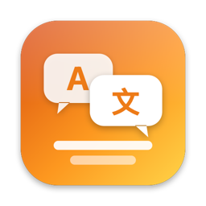
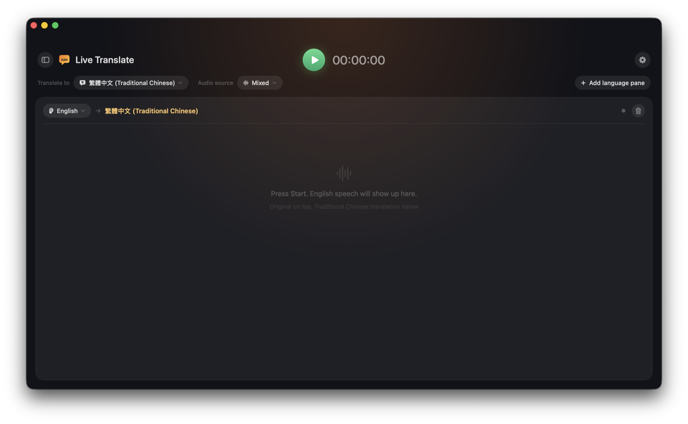
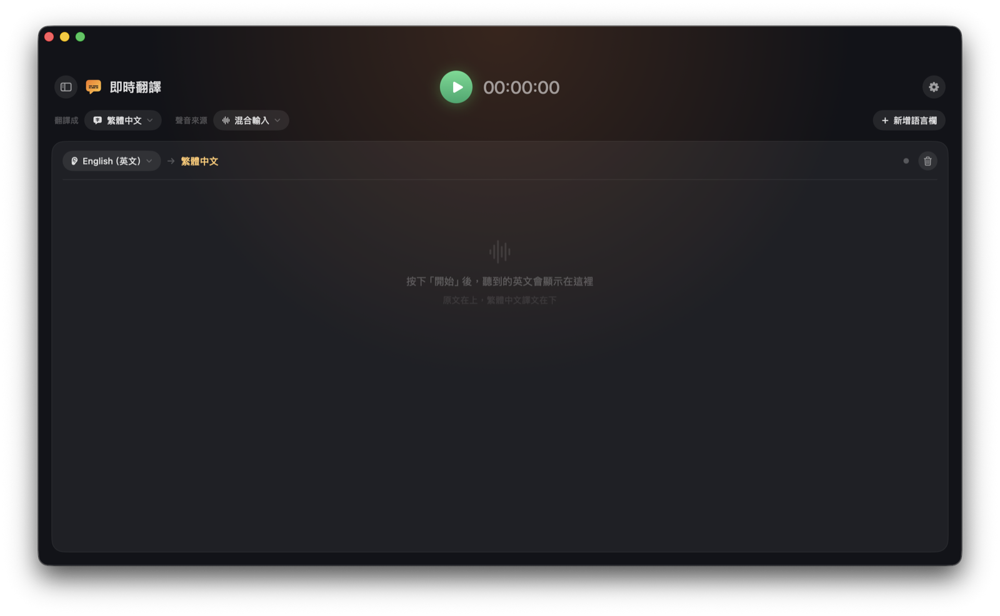
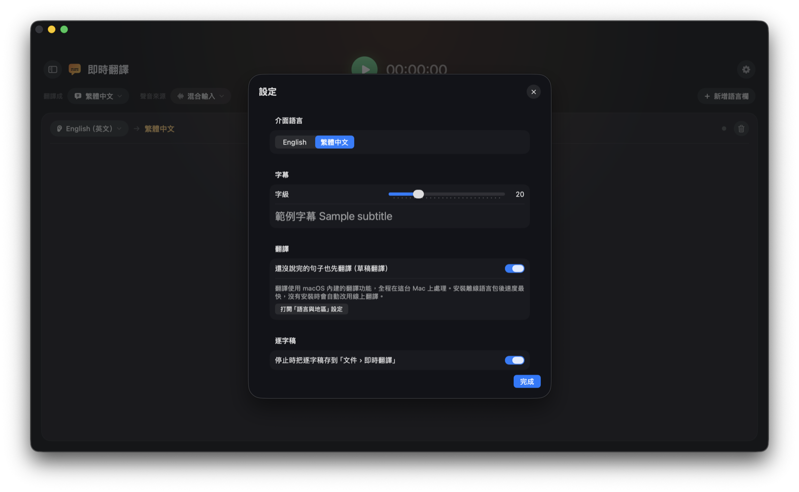

<p align="center">
  
</p>

<h1 align="center">PolyTranslate Live · 多語即譯</h1>

<p align="center">
  Real-time multilingual meeting translation for macOS. Several languages are recognized in parallel and routed to their own pane,<br>
  built entirely on Apple's on-device speech and translation models. No API keys, no subscription, no cloud.
</p>

<p align="center">
  <a href="#english">English</a> · <a href="#繁體中文">繁體中文</a>
</p>

---

## English

### System requirements

| | Requirement |
|---|---|
| macOS | **26.4 (Tahoe) or later** — uses `SpeechAnalyzer` and the `TranslationSession(installedSource:…)` API introduced in macOS 26 / 26.4 |
| Chip | **Apple Silicon** (M1 or later). Intel Macs are not supported. |
| Build tools | Xcode **Command Line Tools** with the macOS 26 SDK. **Xcode itself is not required.** |
| Permissions | Microphone; Screen & System Audio Recording (for capturing what your Mac is playing) |
| Network | Not required. Install the offline translation language packs for fastest results; otherwise macOS falls back to online translation automatically. |

### What it does



- **Pick the language you want to read** at the top (e.g. Traditional Chinese) and the **audio source**: system audio (meetings, videos), microphone, or both mixed.
- **Each pane listens for one language.** Start with one pane (English → Traditional Chinese) and add more — e.g. a Japanese pane — up to four.
- **Automatic routing by language.** Every pane's language is recognized in parallel on the same audio; when a sentence is finalized, the recognizer with the highest confidence wins and the sentence appears in that pane. The target language itself runs as a silent lane so that, say, Chinese speech never shows up as garbage in the English pane.
- **Live drafts.** While someone is still talking you see a gray draft and a draft translation; it turns solid when the sentence ends.
- **Mixed input without mixing audio.** System audio and microphone each get their own recognizers; lines are tagged with a speaker or mic icon.
- **History sidebar.** Every session is saved when you press Stop; browse, copy as text, or delete from the collapsible sidebar.
- **Interface in English or Traditional Chinese.** Language names show as *native name (name in your UI language)*, e.g. `日本語 (Japanese)`.

### Speed (measured on Apple Silicon)

| Stage | Latency |
|---|---|
| First draft word after speech starts | ~1 s |
| Sentence finalized after the speaker pauses | < 0.1 s |
| Translation, offline language pack installed | ~30–80 ms |
| Translation, online fallback | 0.3–1 s |

### Install

```bash
git clone https://github.com/SamLiaoP/polytranslate-live.git
cd polytranslate-live
./build.sh install   # compiles with swiftc, ad-hoc signs, installs to ~/Applications/PolyTranslate Live.app
```

The app then shows up in Launchpad, Spotlight and Finder › Applications like any other app.
`./build.sh run` does the same and launches it; `./build.sh` alone only builds into `build/`.

#### Let an AI install it for you

If you use an AI coding assistant (Claude Code, Codex, Cursor, Copilot, …), just hand it the repo. The
repository ships an [`AGENTS.md`](AGENTS.md) with the exact requirements, commands, permission steps and
a verification routine, so the assistant can do everything except click the permission dialogs. Paste
something like:

> Clone https://github.com/SamLiaoP/polytranslate-live and install it on this Mac. Follow AGENTS.md,
> check the system requirements first, and tell me which permission dialogs I need to click.

On first **Start**, macOS asks for two permissions:

1. **Microphone**.
2. **Screen & System Audio Recording** — needed to capture system audio. After enabling it in System Settings › Privacy & Security, **quit and relaunch the app**.

> The app is ad-hoc signed. After each rebuild macOS may treat it as a new app and ask for Screen Recording again. To avoid that, create a self-signed certificate in Keychain Access and replace `codesign -s -` in `build.sh` with `-s "Your Cert Name"`.

### Faster translation: install offline language packs

System Settings › General › Language & Region › **Translation Languages** → download the languages you use (e.g. English and Traditional Chinese). The app shows a hint with a **Download language pack** button when it detects that it is running on the online fallback.

### Test mode (no permissions needed)

```bash
say -v Samantha -o /tmp/en.wav --data-format=LEI16@16000 "Good morning everyone."
~/Applications/PolyTranslate\ Live.app/Contents/MacOS/PolyTranslateLive --test-wav /tmp/en.wav
```

Feeds the file into the system-audio channel in real time, starts automatically and stops at the end. Log: `~/Library/Logs/PolyTranslateLive.log`.

### How it works

```
System audio (ScreenCaptureKit) ─┐
Microphone (AVAudioEngine)      ─┴─► 16 kHz mono ─► one SpeechAnalyzer lane per language (+ target language)
                                                       │ volatile results → drafts (script-checked)
                                                       │ final results    → Arbiter: confidence vote per sentence,
                                                       │                    trims audio already emitted by another lane
                                                       ▼
                                             Pane for the winning language ─► Translation.framework (.lowLatency,
                                                                               falls back to .highFidelity) ─► UI
```

```
Sources/
  main.swift              AppKit entry point, menus, main window
  AppModel.swift          global state, target language & panes, start/stop, test mode
  RecognitionEngine.swift parallel lanes + Arbiter (confidence vote, overlap trimming, script checks)
  PaneEngine.swift        one pane: receives finals/drafts, translation queue, draft throttling
  SpeechChannel.swift     SpeechAnalyzer wrapper (16 kHz float in → draft/final out)
  AudioCapture.swift      ScreenCaptureKit / AVAudioEngine capture, resampling, AudioHub fan-out
  Translator.swift        AppleTranslator (lowLatency → highFidelity fallback), optional LLM backend, TranslatorHub
  History.swift           session records (JSON in ~/Library/Application Support/PolyTranslateLive/history)
  ContentView.swift       SwiftUI interface
  L10n.swift              string table (English / Traditional Chinese)
  Models.swift            settings, language catalog, data types
  DebugLog.swift          file logger
Resources/Info.plist      permission strings, bundle info
Resources/AppIcon.icns    generated by tools/make_icon.swift (no SF Symbols)
build.sh                  swiftc → .app bundle → ad-hoc codesign → install to ~/Applications
AGENTS.md / CLAUDE.md     instructions for AI coding assistants
```

### Known limitations

- Language routing uses the confidence of *finalized* sentences (measured: correct language ≥ 0.65, wrong language 0.18–0.55). Drafts carry no confidence, so a wrong pane may briefly show a gray draft (e.g. romanized Japanese in the English pane) until the sentence finalizes.
- A sentence is finalized only when the speaker pauses.
- Occasionally the first syllable after a language switch is glued to the previous sentence by the recognizer (e.g. Japanese 「皆さん」→「なさん」).
- Up to 4 panes. macOS only.

### Credits

Written from scratch in Swift. Ideas and API usage patterns were learned from these MIT-licensed projects:
[livesub-macos](https://github.com/ultima6-tw/livesub-macos) (`TranslationSession(installedSource:…)`),
[audicap](https://github.com/ShinoKana/audicap) (swiftc-only build, SpeechAnalyzer measurements, multi-lane arbitration),
[mac-live-captions](https://github.com/jonyen/mac-live-captions) (ScreenCaptureKit audio).

### License

[MIT](LICENSE)

---

## 繁體中文

### 系統需求

| | 需求 |
|---|---|
| macOS | **26.4（Tahoe）以上**。用到 macOS 26 的 `SpeechAnalyzer` 與 26.4 新增的 `TranslationSession(installedSource:…)` |
| 晶片 | **Apple Silicon**（M1 以上）。不支援 Intel Mac。 |
| 建置工具 | Xcode **Command Line Tools**（含 macOS 26 SDK）。**不需要安裝 Xcode。** |
| 權限 | 麥克風；螢幕與系統音訊錄製（擷取電腦播放的聲音用） |
| 網路 | 不需要。裝好離線翻譯語言包速度最快；沒裝時 macOS 會自動改用線上翻譯。 |

### 功能



- **最上面選要翻成的語言**（例如繁體中文）和**聲音來源**：系統聲音（會議、影片）、麥克風，或兩者混合。
- **每個字幕欄聽一種語言。** 預設一欄（英文 → 繁體中文），可以再加，例如加一欄日文，最多四欄。
- **依語言自動分流。** 所有欄位的語言同時辨識同一段聲音，每句話定稿時由信心值最高的辨識器勝出，出現在對應的欄位。目標語言本身也有一條隱藏的通道，所以有人說中文時不會變成英文欄的亂碼。
- **即時草稿。** 對方還在講時先看到灰色草稿和草稿翻譯，說完一句就定稿。
- **混合輸入不混音。** 系統聲音和麥克風各有自己的辨識器，字幕前標記喇叭或麥克風圖示。
- **歷史紀錄側欄。** 每次按停止就存一筆，左側可收納的列表能回看、複製成文字、刪除。
- **介面英文 / 繁體中文。** 語言名稱顯示成「原生名稱（介面語言的翻譯）」，例如 `English（英文）`、`日本語（日文）`。



### 速度（Apple Silicon 實測）

| 階段 | 延遲 |
|---|---|
| 開口後出現第一個草稿字 | 約 1 秒 |
| 講者停頓後定稿 | 0.1 秒內 |
| 翻譯（已裝離線語言包） | 約 30–80 毫秒 |
| 翻譯（線上備援） | 0.3–1 秒 |

### 安裝

```bash
git clone https://github.com/SamLiaoP/polytranslate-live.git
cd polytranslate-live
./build.sh install   # swiftc 編譯 → ad-hoc 簽名 → 安裝到 ~/Applications/PolyTranslate Live.app
```

裝好後 Launchpad、Spotlight、Finder › 應用程式 都找得到，和一般 App 一樣。
`./build.sh run` 會順便啟動；只打 `./build.sh` 則只編譯到 `build/`。

#### 丟給 AI 幫你裝

如果你有在用 AI 程式助理（Claude Code、Codex、Cursor、Copilot 等），直接把 repo 給它就好。
repo 裡附了 [`AGENTS.md`](AGENTS.md)，寫明系統需求、指令、權限步驟和驗證方法，助理除了幫你點權限視窗以外的事都能做。可以這樣說：

> 把 https://github.com/SamLiaoP/polytranslate-live clone 下來裝到這台 Mac，照 AGENTS.md 做，先檢查系統需求，然後告訴我要點哪些權限視窗。

第一次按「開始」會要兩個權限：

1. **麥克風**。
2. **螢幕與系統音訊錄製**：擷取系統聲音要用。到 系統設定 › 隱私權與安全性 開啟後，**完全結束 App 再重開**。

> App 是 ad-hoc 簽名，每次重新 `build.sh` 後 macOS 可能把它當成新 App，要再授權一次螢幕錄製。想避免的話，在鑰匙圈存取建立一張自簽憑證，把 `build.sh` 的 `codesign -s -` 改成 `-s "憑證名稱"`。

### 讓翻譯更快：安裝離線語言包

系統設定 › 一般 › 語言與地區 › **翻譯語言** → 下載你用的語言（例如英文和繁體中文）。App 偵測到正在用線上備援時，欄位上方會出現提示和「下載語言包」按鈕。

### 測試模式（不需要權限）

```bash
say -v Samantha -o /tmp/en.wav --data-format=LEI16@16000 "Good morning everyone."
~/Applications/PolyTranslate\ Live.app/Contents/MacOS/PolyTranslateLive --test-wav /tmp/en.wav
```

會把 wav 以真實時間速度灌進「系統聲音」通道，自動開始、播完自動停止。日誌在 `~/Library/Logs/PolyTranslateLive.log`。

### 已知限制

- 語言分流靠「定稿句子」的信心值（實測正確語言 ≥ 0.65、錯誤語言 0.18–0.55）。草稿沒有信心值，偶爾會在錯的欄位閃一下灰字（例如英文欄短暫出現日文的羅馬拼音），定稿時會消失。
- 一句話要等講者停頓才會定稿。
- 語言切換的第一個字偶爾會被辨識器黏到前一句，例如日文「皆さん」變成「なさん」。
- 最多四欄。只支援 macOS。

### 致謝

程式碼全部重新撰寫。以下 MIT 授權的專案提供了 API 用法與設計上的參考：
[livesub-macos](https://github.com/ultima6-tw/livesub-macos)、[audicap](https://github.com/ShinoKana/audicap)、[mac-live-captions](https://github.com/jonyen/mac-live-captions)。

### 授權

[MIT](LICENSE)
